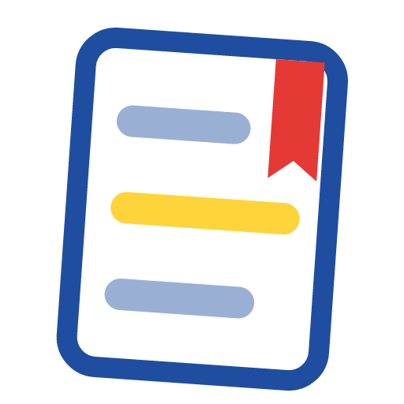
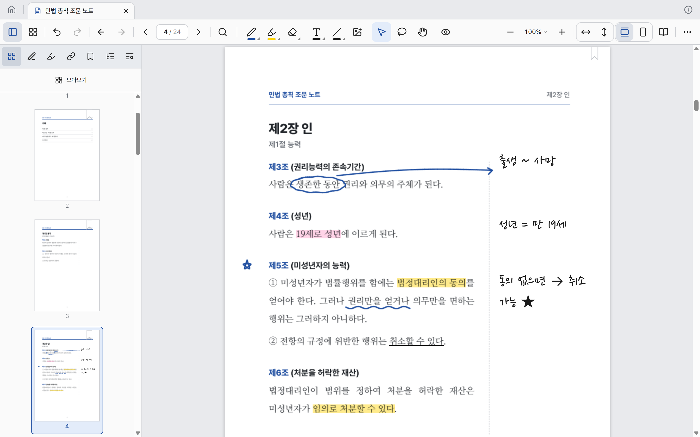
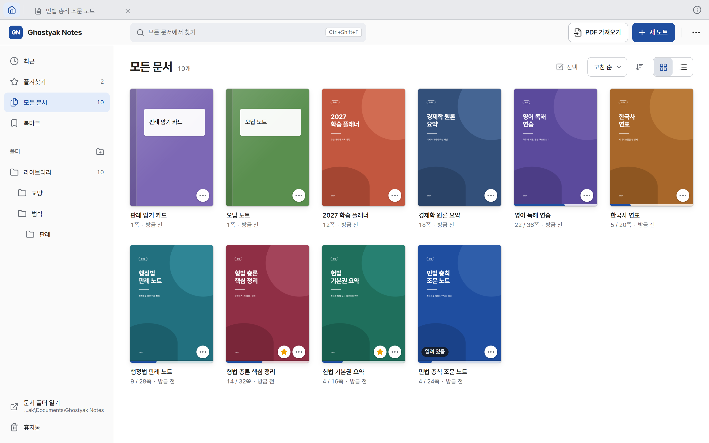
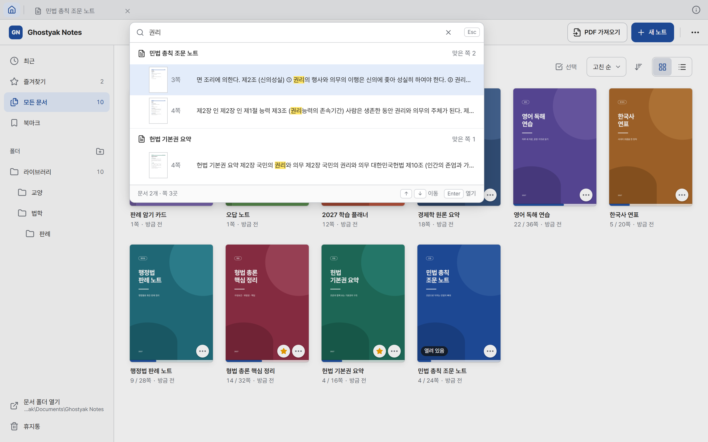
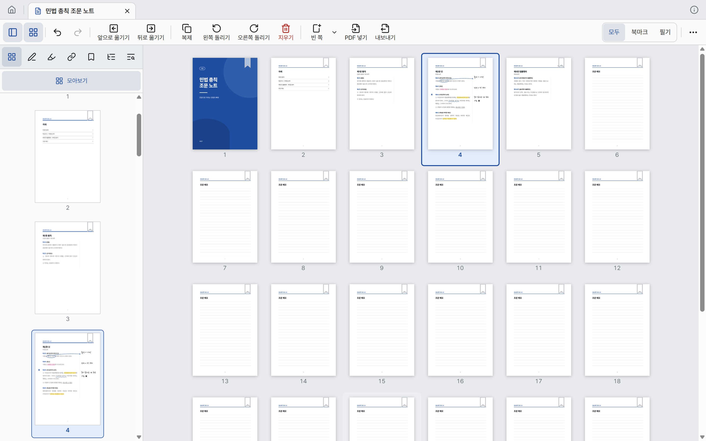
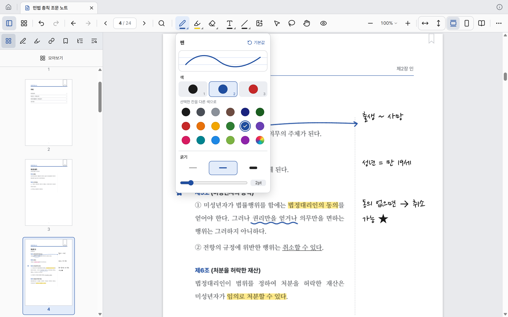
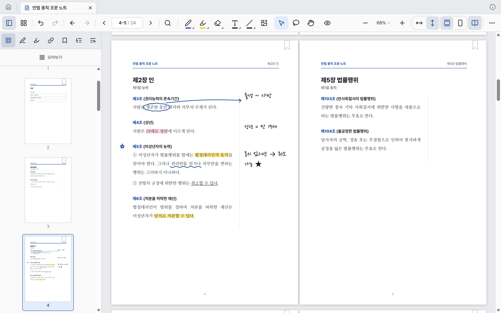

  

<h1 align="center">Ghostyak Notes</h1>

  PDF 위에 손으로도 쓰고 키보드로도 쓰며, 
  쓴 것과 읽은 것을 무엇이든 바로 찾는 Windows용 노트 앱

  <a href="../../releases/latest"><b>최신 버전 내려받기</b></a>
  &nbsp;·&nbsp;
  <a href="https://www.ghostyak.com/ko/product/notes">제품 소개</a>
  &nbsp;·&nbsp;
  <a href="../../issues">의견·버그 알리기</a>
  &nbsp;·&nbsp;
  <a href="#english">English</a>

> **30일 체험판입니다.** 처음 실행한 날부터 30일 동안 모든 기능을 쓸 수 있고, 기간이 끝나도 필기는 계속 쓸 수 있습니다. 자세한 것은 아래 [체험판](#체험판)을 읽어 주세요.

## 무엇을 할 수 있나

**읽기**
- 수백 쪽짜리 PDF를 연속 스크롤, 한 쪽 보기, 두 쪽 보기로 읽습니다. 여러 문서를 탭으로 엽니다.
- 쪽 목록, PDF 목차, 북마크, 필기한 쪽, 표시한 글로 원하는 곳에 바로 갑니다.

**쓰기**
- 펜, 형광펜, 지우개(획 단위 · 닿은 부분만), 도형(선·화살표·사각형·타원), 이미지.
- 텍스트 상자에 키보드로 칩니다. 글꼴, 글자 크기, 줄 간격을 바꿉니다. 펜이 없어도 불편하지 않습니다.
- PDF의 글을 끌어 선택해 형광·밑줄·취소선을 붙이거나, 덮어 가린 뒤 엿보기로 열어 봅니다(암기용).
- 올가미로 둘러싸 옮기고, 크기를 바꾸고, 복사합니다.
- 선택한 글이나 넣은 것에 링크를 걸어 같은 문서의 다른 곳이나 웹 주소로 갑니다.
- 저장 단추가 없습니다. 쓰는 대로 저장됩니다.

**찾기**
- 문서 안에서 찾기(`Ctrl+F`)와 모든 문서에서 찾기(`Ctrl+Shift+F`). PDF의 글과 직접 친 글이 함께 나옵니다.
- 글자가 없는 스캔 PDF는 앱이 뒤에서 글자를 인식(OCR)해 찾을 수 있게 합니다. 한국어·영어·일본어.
- 빠른 이동(`Ctrl+K`)으로 명령과 문서를 이름으로 찾습니다.

**정리하고 내보내기**
- 모아보기(`F5`)에서 쪽을 옮기고, 지우고, 돌리고, 복사합니다. 빈 쪽(무지·줄·모눈·점·코넬)이나 다른 PDF의 쪽을 넣습니다.
- 폴더, 즐겨찾기, 최근 문서, 휴지통으로 문서를 정리합니다.
- 필기를 넣은 PDF로 내보내고(`Ctrl+Shift+E`) 인쇄합니다(`Ctrl+P`).

**그 밖에**
- 화면은 한국어와 영어, 밝은 테마와 어두운 테마. 단축키는 설정에서 바꿀 수 있습니다.

| 라이브러리 | 모든 문서에서 찾기 |
|---|---|
|  |  |

| 펜 설정 | 두 쪽 보기 |
|---|---|
|  |  |

## 내 파일은 내 것

- **인터넷 없이 모두 동작합니다.** 글자 인식(OCR)도 기기 안에서 합니다. 문서의 내용을 밖으로 보내지 않고, 계정도 없습니다.
  - 글을 선택하고 "사전"을 누르면 그 낱말의 사전 검색 화면이 기본 브라우저로 열립니다. 누를 때만 일어납니다.
  - Pro 라이선스를 활성화하거나 해제할 때와, 활성화한 기기를 켜서 라이선스를 확인할 때 결제 대행사(Freemius)에 요청을 보냅니다. 체험판은 보내지 않습니다.
  - 실험실에서 AI를 켜고 모델 내려받기를 누르면 모델 파일을 Hugging Face에서 받습니다.
- **문서는 `문서\Ghostyak Notes` 폴더에 평범한 파일(`.gnote`)로 있습니다.** 이 폴더를 복사해 두면 그것이 백업입니다. 앱을 지워도 이 폴더는 남습니다.
- **원본 PDF는 바꾸지 않습니다.** 필기는 따로 저장되고, 필기를 넣은 PDF가 필요하면 내보냅니다.

## 설치

1. [Releases](../../releases/latest)에서 `ghostyak-notes-latest-x64-setup.exe`를 내려받습니다.
2. 실행합니다. **"Windows의 PC 보호" 창이 뜨면 "추가 정보" → "실행"을 누릅니다.** 아직 코드 서명을 하지 않아 뜨는 경고입니다.
3. 설치가 끝나면 시작 메뉴에서 **Ghostyak Notes**를 실행합니다.

| | |
|---|---|
| 운영 체제 | Windows 10 / 11 (64비트) |
| 설치 파일 크기 | 약 75MB |
| 필요한 것 | Microsoft Edge WebView2 런타임. Windows 11에는 들어 있고, 없으면 설치 프로그램이 내려받아 깝니다(이때만 인터넷이 필요합니다) |

**새 버전으로 올리기**: 자동 업데이트는 없습니다. 새 설치 파일을 내려받아 그대로 실행하면 됩니다. 문서는 그대로 남고, 체험 기간은 늘어나지 않습니다.

## 체험판

v1.0.0부터 설치본은 모두 30일 체험판입니다.

- **처음 실행한 날부터 30일 동안 모든 기능을 씁니다.** 기간은 기기마다 한 번이고, 새 버전을 설치해도 늘어나지 않습니다. 베타를 쓰던 PC에 v1.0.0을 설치하면 체험이 새로 시작됩니다.
- **기간이 끝나도 필기는 계속 쓸 수 있습니다.** 아래 표의 Pro 기능만 쓸 수 없게 됩니다. 만든 문서와 필기, 이미 인식한 글은 그대로 남습니다.

| 기간이 끝난 뒤에도 되는 것 | Pro 기능 |
|---|---|
| 문서 읽기, 필기, 글 표시, 북마크, 목차, 링크, 쪽 편집, 실행 취소 | 문자인식(OCR): 이 쪽, 여러 쪽, 문서 전체 |
| 새 노트, 문서 합치기, PDF 가져오기, 문서 정리 | 문자인식(OCR) 자동모드, 성능모드 |
| 문서 안에서 찾기, 빠른 이동 | 모든 문서에서 한 번에 찾기 |
| 이미 인식한 글 찾기와 복사 | 홈의 모든 북마크, 모든 표시한 글 |
| 필기를 넣은 PDF로 내보내기, 인쇄 | 미니맵 |

- 기간은 기기의 시계로 셉니다(인터넷을 쓰지 않습니다). 기기의 날짜를 되돌리면 기간이 끝난 것으로 봅니다.
- Pro 기능을 계속 쓰려면 Pro가 필요합니다. Pro는 일회 구매이고 구매 뒤 업데이트가 포함되며, 키 하나로 기기 3대까지 활성화할 수 있습니다. 구매 기능은 만들고 있으며 곧 제공될 예정입니다. 자세한 내용은 [체험판과 Pro 비교](https://www.ghostyak.com/ko/product/notes#pricing)에서 볼 수 있습니다.

## 자주 쓰는 단축키

| 하는 일 | 키 |
|---|---|
| 펜 / 형광펜 / 지우개 / 올가미 / 텍스트 / 도형 | `P` / `H` / `E` / `L` / `T` / `S` |
| 커서(글 선택) / 손(화면 옮기기) / 반투명 | `V` / `G` / `X` |
| 실행 취소 / 다시 실행 | `Ctrl+Z` / `Ctrl+Y` |
| 문서에서 찾기 / 모든 문서에서 찾기 / 빠른 이동 | `Ctrl+F` / `Ctrl+Shift+F` / `Ctrl+K` |
| 북마크 달기·떼기 | `Ctrl+D` |
| 쪽 번호로 이동 | `Ctrl+G` |
| 모아보기 / 왼쪽 사이드바 / 더보기 | `F5` / `F4` 또는 `Ctrl+B` / `F10` |
| PDF 가져오기 / 내보내기 / 인쇄 | `Ctrl+O` / `Ctrl+Shift+E` / `Ctrl+P` |
| 라이브러리로 / 탭 닫기 | `Ctrl+T` / `Ctrl+W` |
| 설정 | `Ctrl+,` |

모든 명령은 빠른 이동(`Ctrl+K`)에서 이름으로 찾을 수 있고, 단축키는 설정에서 바꿉니다.

## 알려진 제약

- Windows 전용입니다.
- 손글씨는 검색되지 않습니다(직접 친 글, PDF의 글, 스캔에서 인식한 글이 검색됩니다).
- 일본어는 낱말 그대로 찾습니다. 활용형이 다르면 찾지 못합니다.
- 기기 간 동기화는 아직 없습니다.

## 더 알아보기

- 제품 소개와 체험판·Pro 안내: [ghostyak.com/ko/product/notes](https://www.ghostyak.com/ko/product/notes)
- 새 버전 소식: [GhostYak 블로그](https://www.ghostyak.com/ko/blog)

## 의견과 버그

[Issues](../../issues)에 남겨 주세요. 다음을 적어 주시면 빨리 고칠 수 있습니다.

- 앱의 버전과 Windows 버전. 앱의 버전은 탭 줄 오른쪽 끝의 ⓘ를 누르면 나오는 "정보"에서 보고 복사할 수 있습니다
- 무엇을 하다가 어떻게 됐는지, 되풀이해서 일어나는지
- 펜을 쓰는 기기라면 기기 이름

문서의 내용이 드러나는 화면 캡처나 파일은 올리기 전에 한 번 살펴 주세요. 이곳은 누구나 볼 수 있습니다.

## 라이선스

Ghostyak Notes는 오픈소스가 아닙니다. 이 저장소는 설치 파일을 내놓고 의견을 받는 곳이며, 소스 코드는 들어 있지 않습니다.

앱에는 오픈소스 소프트웨어와 글꼴, 모델이 들어 있습니다: PDFium, ONNX Runtime, PP-OCRv5(PaddleOCR), Tauri, Svelte, SQLite, Tantivy, Lindera(한국어 사전 ko-dic), Pretendard, 나눔 글꼴 등. 전체 목록과 저작권 표시, 라이선스 전문은 앱의 "정보"(탭 줄 오른쪽 끝의 ⓘ → "고지 전문 보기")와 설치 폴더의 `licenses\THIRD-PARTY-NOTICES.txt`에 있습니다.

© 2026 박영기 Park Young Gi (Ghostyak)

---

## English

**Ghostyak Notes** is a note-taking app for Windows: write on PDFs by hand or by keyboard, and find anything you wrote or read. Product page: [ghostyak.com/en/product/notes](https://www.ghostyak.com/en/product/notes).

- Pen, highlighter, eraser, shapes, images, and text boxes on top of your PDFs. The original PDF is never modified.
- Search inside a document or across your whole library. Scanned PDFs are recognized on-device (OCR: Korean, English, Japanese).
- Bookmarks, outline, page thumbnails, page editing, in-document links, folders, tabs.
- Export to PDF with your annotations, and print.
- Works offline with no account, and your documents are never uploaded. The app goes online only for Pro license activation and checks and for AI model downloads you start yourself. Documents are plain files in `Documents\Ghostyak Notes`.
- The interface is available in Korean and English.

**Install**: download `ghostyak-notes-latest-x64-setup.exe` from [Releases](../../releases/latest) and run it. The installer is not code-signed yet, so Windows SmartScreen will warn you: choose "More info" → "Run anyway". Requires Windows 10/11 (64-bit).

**Trial**: since v1.0.0 every build is a 30-day trial. All features work for 30 days from first launch, once per device; installing a newer build does not extend it. After that you can keep annotating and using everything else; only OCR (including single pages), Auto Mode, Performance Mode, searching all documents, all bookmarks and all marked text on the home screen, and the minimap turn off. Your documents, annotations, and already recognized text are never deleted. Those features require Pro, a one-time purchase with updates included that activates up to 3 devices; purchasing is coming soon. See [trial vs. Pro](https://www.ghostyak.com/en/product/notes#pricing).

Feedback and bug reports are welcome in [Issues](../../issues). The app version is shown under the ⓘ button at the right end of the tab bar.

Ghostyak Notes is not open source. Third-party notices are available in the app (ⓘ → About) and in `licenses\THIRD-PARTY-NOTICES.txt` in the install folder.

© 2026 박영기 Park Young Gi (Ghostyak)
