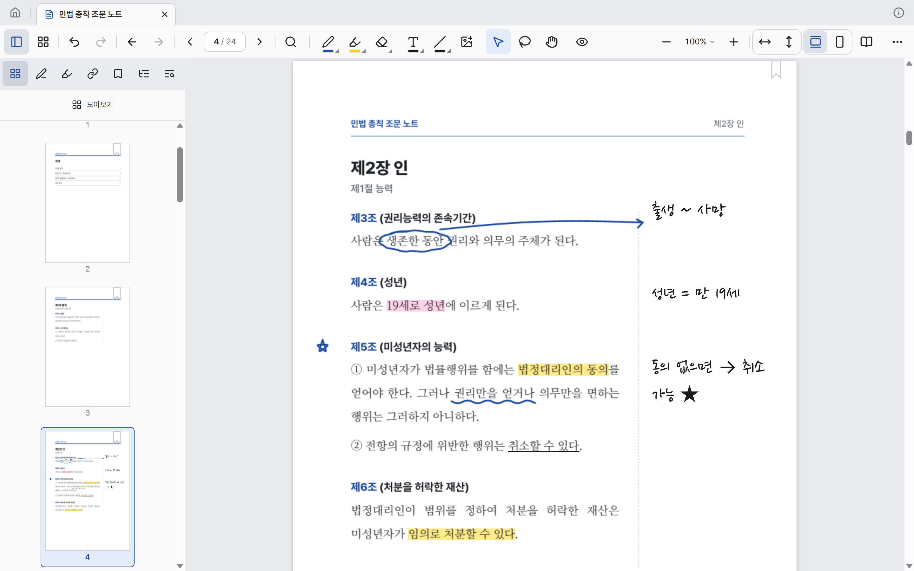
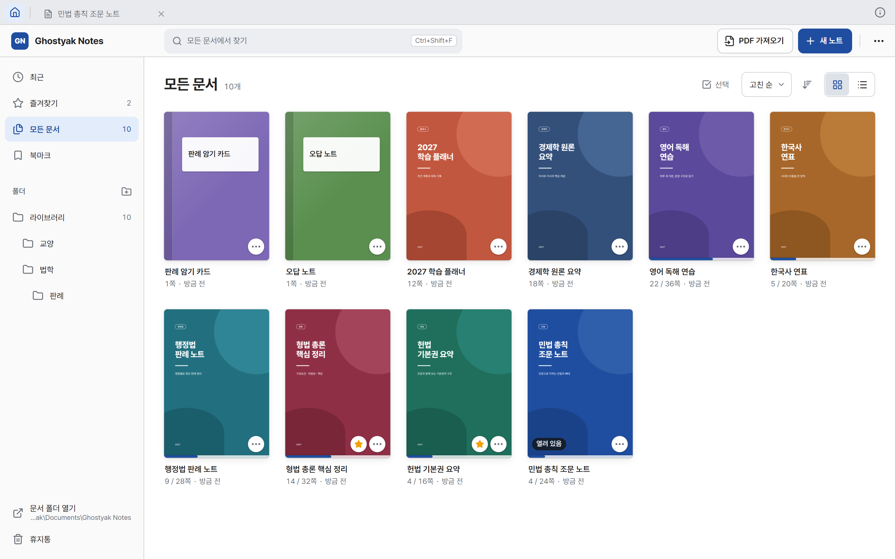
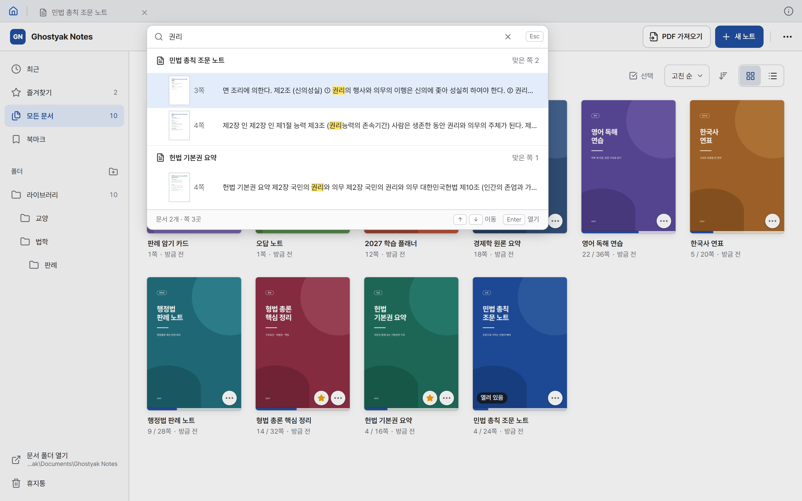
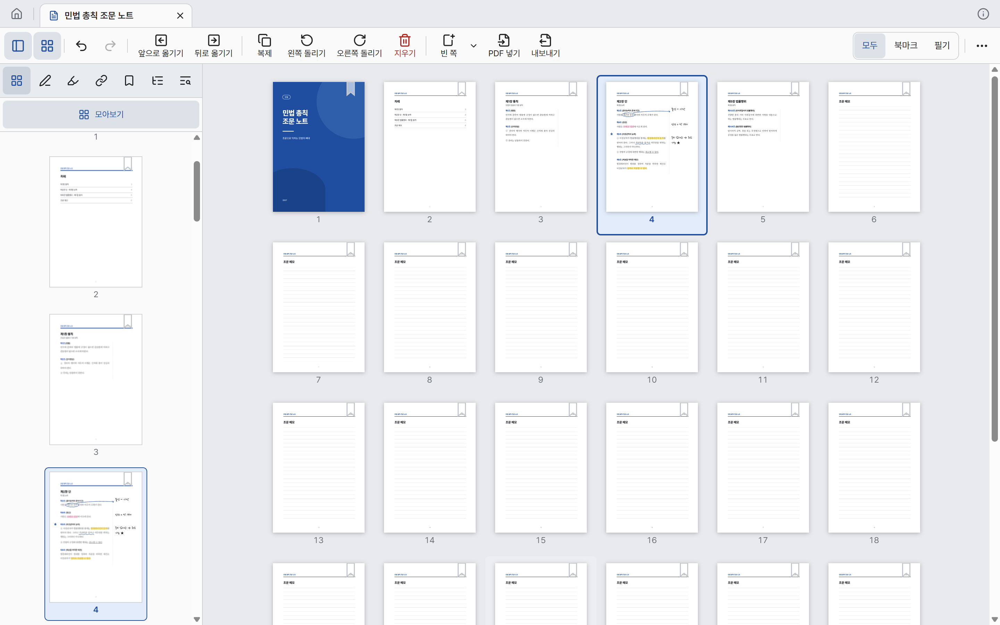
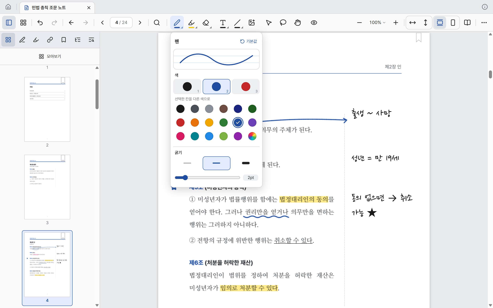
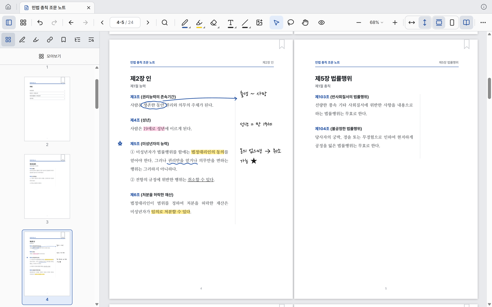

  

<h1 align="center">Ghostyak Notes</h1>

  PDF 위에 손으로도 쓰고 키보드로도 쓰며, 
  쓴 것과 읽은 것을 무엇이든 바로 찾는 Windows용 노트 앱

  <a href="../../releases/latest"><b>최신 버전 내려받기</b></a>
  &nbsp;·&nbsp;
  <a href="../../issues">의견·버그 알리기</a>
  &nbsp;·&nbsp;
  <a href="#english">English</a>

> **지금은 베타 시험판입니다.** 처음 실행한 날부터 14일 동안 모든 기능을 쓸 수 있습니다. 자세한 것은 아래 [베타 시험판](#베타-시험판)을 읽어 주세요.

## 무엇을 할 수 있나

**읽기**
- 수백 쪽짜리 PDF를 연속 스크롤, 한 쪽 보기, 두 쪽 보기로 읽습니다. 여러 문서를 탭으로 엽니다.
- 쪽 목록, PDF 목차, 북마크, 필기한 쪽, 표시한 글로 원하는 곳에 바로 갑니다.

**쓰기**
- 펜, 형광펜, 지우개(획 단위 · 닿은 부분만), 도형(선·화살표·사각형·타원), 이미지.
- 텍스트 상자에 키보드로 칩니다. 글꼴, 글자 크기, 줄 간격을 바꿉니다. 펜이 없어도 불편하지 않습니다.
- PDF의 글을 끌어 선택해 형광·밑줄·취소선을 붙이거나, 덮어 가린 뒤 엿보기로 열어 봅니다(암기용).
- 올가미로 둘러싸 옮기고, 크기를 바꾸고, 복사합니다.
- 선택한 글이나 넣은 것에 링크를 걸어 같은 문서의 다른 곳이나 웹 주소로 갑니다.
- 저장 단추가 없습니다. 쓰는 대로 저장됩니다.

**찾기**
- 문서 안에서 찾기(`Ctrl+F`)와 모든 문서에서 찾기(`Ctrl+Shift+F`). PDF의 글과 직접 친 글이 함께 나옵니다.
- 글자가 없는 스캔 PDF는 앱이 뒤에서 글자를 인식(OCR)해 찾을 수 있게 합니다. 한국어·영어·일본어.
- 빠른 이동(`Ctrl+K`)으로 명령과 문서를 이름으로 찾습니다.

**정리하고 내보내기**
- 모아보기(`F4`)에서 쪽을 옮기고, 지우고, 돌리고, 복사합니다. 빈 쪽(무지·줄·모눈·점·코넬)이나 다른 PDF의 쪽을 넣습니다.
- 폴더, 즐겨찾기, 최근 문서, 휴지통으로 문서를 정리합니다.
- 필기를 넣은 PDF로 내보내고(`Ctrl+Shift+E`) 인쇄합니다(`Ctrl+P`).

**그 밖에**
- 화면은 한국어와 영어, 밝은 테마와 어두운 테마. 단축키는 설정에서 바꿀 수 있습니다.

| 라이브러리 | 모든 문서에서 찾기 |
|---|---|
|  |  |

| 펜 설정 | 두 쪽 보기 |
|---|---|
|  |  |

## 내 파일은 내 것

- **인터넷 없이 모두 동작합니다.** 글자 인식(OCR)도 기기 안에서 합니다. 문서의 내용을 밖으로 보내지 않고, 계정도 없습니다.
  - 하나의 예외: 글을 선택하고 "사전"을 누르면 그 낱말의 사전 검색 화면이 기본 브라우저로 열립니다. 누를 때만 일어납니다.
- **문서는 `문서\Ghostyak Notes` 폴더에 평범한 파일(`.gnote`)로 있습니다.** 이 폴더를 복사해 두면 그것이 백업입니다. 앱을 지워도 이 폴더는 남습니다.
- **원본 PDF는 바꾸지 않습니다.** 필기는 따로 저장되고, 필기를 넣은 PDF가 필요하면 내보냅니다.

## 설치

1. [Releases](../../releases/latest)에서 `ghostyak-notes_<버전>_x64-setup.exe`를 내려받습니다.
2. 실행합니다. **"Windows의 PC 보호" 창이 뜨면 "추가 정보" → "실행"을 누릅니다.** 아직 코드 서명을 하지 않아 뜨는 경고입니다.
3. 설치가 끝나면 시작 메뉴에서 **Ghostyak Notes**를 실행합니다.

| | |
|---|---|
| 운영 체제 | Windows 10 / 11 (64비트) |
| 설치 파일 크기 | 약 57MB |
| 필요한 것 | Microsoft Edge WebView2 런타임. Windows 11에는 들어 있고, 없으면 설치 프로그램이 내려받아 깝니다(이때만 인터넷이 필요합니다) |

**새 버전으로 올리기**: 자동 업데이트는 없습니다. 새 설치 파일을 내려받아 그대로 실행하면 됩니다. 문서는 그대로 남습니다.

## 베타 시험판

버전 이름이 `-beta`로 끝나는 설치본은 베타 시험판입니다.

- **처음 실행한 날부터 14일 동안 모든 기능을 씁니다.** 새 버전을 설치하면 다시 14일입니다.
- **기간이 끝나면 읽기만 할 수 있습니다.** 만든 문서와 필기는 지워지지 않습니다.

| 기간이 끝난 뒤에도 되는 것 | 안 되는 것 |
|---|---|
| 문서 열어 읽기, 필기 보기 | 필기(펜·형광펜·텍스트·도형·이미지·글 표시) |
| 문서 안에서 찾기, 빠른 이동 | 모든 문서에서 찾기 |
| PDF 가져오기 | 새 노트 |
| 필기를 넣은 PDF로 내보내기, 인쇄 | 북마크 달기, 쪽 편집, 실행 취소 |
| 문서 정리(이름 바꾸기, 폴더, 휴지통) | |

- 기간은 기기의 시계로 셉니다(인터넷을 쓰지 않습니다). 기기의 날짜를 되돌리면 기간이 끝난 것으로 봅니다.
- 설치 파일마다 최종 만료일이 있습니다(만든 날부터 42일). 오래된 설치 파일보다 최신 버전을 받아 주세요.

## 자주 쓰는 단축키

| 하는 일 | 키 |
|---|---|
| 펜 / 형광펜 / 지우개 / 올가미 / 텍스트 / 도형 | `P` / `H` / `E` / `L` / `T` / `S` |
| 커서(글 선택) / 손(화면 옮기기) / 엿보기 | `V` / `G` / `X` |
| 실행 취소 / 다시 실행 | `Ctrl+Z` / `Ctrl+Y` |
| 문서에서 찾기 / 모든 문서에서 찾기 / 빠른 이동 | `Ctrl+F` / `Ctrl+Shift+F` / `Ctrl+K` |
| 북마크 달기·떼기 | `Ctrl+D` |
| 쪽 번호로 이동 | `Ctrl+G` |
| 모아보기 / 왼쪽 사이드바 / 더보기 | `F4` / `F9` / `F10` |
| PDF 가져오기 / 내보내기 / 인쇄 | `Ctrl+O` / `Ctrl+Shift+E` / `Ctrl+P` |
| 라이브러리로 / 탭 닫기 | `Ctrl+T` / `Ctrl+W` |
| 설정 | `Ctrl+,` |

모든 명령은 빠른 이동(`Ctrl+K`)에서 이름으로 찾을 수 있고, 단축키는 설정에서 바꿉니다.

## 알려진 제약

- Windows 전용입니다.
- 손글씨는 검색되지 않습니다(직접 친 글, PDF의 글, 스캔에서 인식한 글이 검색됩니다).
- 일본어는 낱말 그대로 찾습니다. 활용형이 다르면 찾지 못합니다.
- 화면 분할, 기기 간 동기화는 아직 없습니다.

## 의견과 버그

[Issues](../../issues)에 남겨 주세요. 다음을 적어 주시면 빨리 고칠 수 있습니다.

- 앱의 버전과 Windows 버전. 앱의 버전은 창 제목줄에 보이고, 탭 줄 오른쪽 끝의 ⓘ를 누르면 나오는 "정보"에서 복사할 수 있습니다
- 무엇을 하다가 어떻게 됐는지, 되풀이해서 일어나는지
- 펜을 쓰는 기기라면 기기 이름

문서의 내용이 드러나는 화면 캡처나 파일은 올리기 전에 한 번 살펴 주세요. 이곳은 누구나 볼 수 있습니다.

## 라이선스

Ghostyak Notes는 오픈소스가 아닙니다. 이 저장소는 설치 파일을 내놓고 의견을 받는 곳이며, 소스 코드는 들어 있지 않습니다.

앱에는 오픈소스 소프트웨어와 글꼴, 모델이 들어 있습니다: PDFium, ONNX Runtime, PP-OCRv5(PaddleOCR), Tauri, Svelte, SQLite, Tantivy, Lindera(한국어 사전 ko-dic), Pretendard, 나눔 글꼴 등. 전체 목록과 저작권 표시, 라이선스 전문은 앱의 "정보"(탭 줄 오른쪽 끝의 ⓘ → "고지 전문 보기")와 설치 폴더의 `licenses\THIRD-PARTY-NOTICES.txt`에 있습니다.

© 2026 박영기 Park Young Gi (Ghostyak)

---

## English

**Ghostyak Notes** is a note-taking app for Windows: write on PDFs by hand or by keyboard, and find anything you wrote or read.

- Pen, highlighter, eraser, shapes, images, and text boxes on top of your PDFs. The original PDF is never modified.
- Search inside a document or across your whole library. Scanned PDFs are recognized on-device (OCR: Korean, English, Japanese).
- Bookmarks, outline, page thumbnails, page editing, in-document links, folders, tabs.
- Export to PDF with your annotations, and print.
- Works fully offline. No account, nothing is uploaded. Documents are plain files in `Documents\Ghostyak Notes`.
- The interface is available in Korean and English.

**Install**: download `ghostyak-notes_<version>_x64-setup.exe` from [Releases](../../releases/latest) and run it. The installer is not code-signed yet, so Windows SmartScreen will warn you: choose "More info" → "Run anyway". Requires Windows 10/11 (64-bit).

**Beta**: builds whose version ends in `-beta` are fully functional for 14 days from first launch; installing a newer build starts another 14 days. After that the app becomes read-only (you can still open, read, search within a document, import PDFs, export and print). Your documents and annotations are never deleted.

Feedback and bug reports are welcome in [Issues](../../issues). The app version is shown in the title bar and under the ⓘ button at the right end of the tab bar.

Ghostyak Notes is not open source. Third-party notices are available in the app (ⓘ → About) and in `licenses\THIRD-PARTY-NOTICES.txt` in the install folder.

© 2026 박영기 Park Young Gi (Ghostyak)
